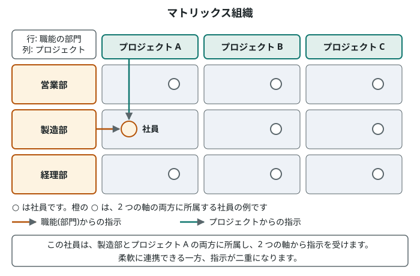

# FE テキスト 3.0 組織活動

企業の社会的な責任、組織の形、人の管理、事業の継続、お金の見方と計算、組織を守る内部統制と監査を学びます。

## 3.1 経営・組織論

### 1. 組織活動と経営資源

経営資源は、ヒト(人材)、モノ(設備)、カネ(資金)、情報です。

| 用語 | 内容 |
|---|---|
| 企業の社会的責任(CSR) | 企業が、法令を守るだけでなく、社会や環境に対する責任を果たす活動 |
| ESG 投資 | 財務情報に加えて、環境(E)、社会(S)、ガバナンス(G)への取組も考慮して投資先を選ぶ |
| グリーン IT | IT 機器の省電力化や、IT を使った環境負荷の低減に取り組む |
| カーボンフットプリント | 製品の原材料の調達から廃棄・リサイクルまでの温室効果ガスの排出量を、CO2 に換算して示す |

### 2. 経営管理

**経営組織の形**

| 組織 | 内容 | 特徴 |
|---|---|---|
| 職能別組織 | 営業、製造、経理など、機能ごとに部門を分ける | 専門性が高まる。部門をまたぐ調整に時間がかかる |
| 事業部制組織 | 製品、地域、顧客ごとに事業部を作り、事業部ごとに権限と責任を持たせる | 意思決定が速い。機能が事業部ごとに重複する |
| マトリックス組織 | 職能の軸と、プロジェクトや事業の軸の両方に所属する | 柔軟に連携できる。指示が二重になる |

職能別組織と事業部制組織の形を、並べた図です。

```text
職能別組織: 営業、製造、経理など、機能ごとに部門を分ける
社長
  +-- 営業部
  +-- 製造部
  `-- 経理部

事業部制組織: 製品、地域、顧客ごとに事業部を作る
社長
  +-- A 製品事業部
  |     +-- 営業
  |     `-- 製造
  `-- B 製品事業部
        +-- 営業
        `-- 製造
```

事業部制組織では、事業部ごとに同じ機能が重複します。

マトリックス組織は、職能の軸とプロジェクトの軸の格子で表します。



**ヒューマンリソースマネジメント**

- **タレントマネジメント**: 従業員のスキル、経歴、適性を把握して、配置や育成に生かす。
- **SMART の法則**: 目標の設定の条件。Specific(具体的)、Measurable(測定可能)、Achievable(達成可能)、Related(関連がある)、Time-bound(期限がある)。
- **目標管理制度(MBO)**: 本人が上司と話し合って目標を設定し、その達成度で評価する。

**行動科学**

| 用語 | 内容 |
|---|---|
| ロジカルシンキング | 論理的に考えて、筋道を立てる |
| ロジックツリー | 課題を、漏れなく重複なく分解して、木の形に整理する |
| 垂直思考 | 論理を順に積み上げて、結論を導く |
| 水平思考 | 既存の枠組みにとらわれず、視点を変えて発想する |
| 仮説思考 | 先に仮の結論を立て、検証しながら進める |
| ブレーンストーミング | 批判をしない、量を重視する、便乗を歓迎する、自由に発言する、というルールでアイデアを出す |
| XY 理論 | X 理論は、人は怠けやすく、命令や統制が必要だと考える。Y 理論は、人は意欲を持って働き、自主性を引き出すと考える(マグレガー) |
| コンティンジェンシー理論 | 最適な管理やリーダーシップは、状況によって変わると考える |
| シェアードリーダーシップ | リーダーの役割を固定せず、チーム全員が状況に応じて発揮する |
| サーバントリーダーシップ | リーダーがメンバーに奉仕し、成長や働きやすさを支える |

**事業継続計画**

- **事業継続計画(BCP)**: 災害やシステム障害などが起きても、重要な事業を継続するか、早期に復旧するための計画。
- **事業継続マネジメント(BCM)**: BCP を策定し、訓練、点検、見直しを繰り返して、継続的に改善する管理活動。

**ファシリティマネジメント**

- **ファシリティマネジメント(FM)**: 土地、建物、設備などの施設を、経営の資源として、計画、運用、改善する活動。
- **ファシリティのライフサイクル**: 計画、建設、運用、廃棄の全体で、費用や環境への影響を考える。
- **環境対策**: 省エネルギー、再生可能エネルギーの利用など。
- **ZEB(net Zero Energy Building)**: 省エネと創エネで、年間の一次エネルギーの消費量を、正味でおおむねゼロにすることを目指す建物。

### 3. 会計・財務

**売上と利益の関係**

- **固定費**: 売上に関係なくかかる費用(家賃、正社員の給与)。
- **変動費**: 売上に比例してかかる費用(材料費)。
- **限界利益** = 売上高 − 変動費。**営業利益** = 売上高 − 変動費 − 固定費。
- **損益分岐点**: 利益がちょうど 0 になる売上高(または販売数量)。

損益分岐点の売上高 = 固定費 ÷(1 − 変動費率)。変動費率 = 変動費 ÷ 売上高。

例 1: 固定費 600 万円、変動費率 60% なら、600 ÷ 0.4 = 1,500 万円。

例 2: 1 個 2,000 円、変動費 1,200 円、固定費 400 万円のとき、1 個あたりの限界利益は 800 円で、損益分岐点の販売数量は 4,000,000 ÷ 800 = 5,000 個。6,000 個売ると、営業利益は 800 × 6,000 − 4,000,000 = 80 万円。

目標の利益を出すのに必要な売上高 =(固定費 + 目標の利益)÷(1 − 変動費率)。

**決算の仕組み**

- **連結決算**: 親会社と子会社をまとめて、1 つの企業グループとして決算をする。連結貸借対照表、連結損益計算書を作る。
- **支配力基準**: 議決権の過半数を持つ場合に限らず、実質的に支配しているかで、子会社かどうかを判断する。
- **有価証券報告書**: 上場企業などが、決算ごとに、財務情報や事業の内容を開示する書類。
- **決算短信**: 決算の概要を速報としてまとめた書類。
- **IFRS**: 国際財務報告基準。国際的な会計基準。

**財務諸表**

| 財務諸表 | 内容 |
|---|---|
| 貸借対照表(B/S) | ある時点の財政状態。資産 = 負債 + 純資産 |
| 損益計算書(P/L) | 一定期間の収益、費用、利益 |
| キャッシュフロー計算書 | 一定期間の現金の流れ |

貸借対照表の分類:

| 区分 | 内容 |
|---|---|
| 流動資産 | 現金、売掛金、棚卸資産など。営業の循環の中にあるものと、1 年以内に現金になるもの |
| 固定資産 | 建物、設備、長期の投資など |
| 流動負債 | 買掛金、短期借入金など。営業の循環の中にあるものと、1 年以内に返済するもの |
| 固定負債 | 長期借入金など |
| 純資産 | 資産から負債を引いた、株主のもの(資本金、利益剰余金など) |

主な財務指標:

| 指標 | 式 | 見方 |
|---|---|---|
| 流動比率 | 流動資産 ÷ 流動負債 | 短期の支払い能力。高いほど余裕がある |
| 自己資本比率 | 自己資本 ÷ 総資産 | 高いほど、財務が安定している |
| ROA | 当期純利益 ÷ 総資産 | 総資産を使った利益の効率 |
| ROE | 当期純利益 ÷ 自己資本 | 株主の資金を使った利益の効率 |
| 売上高純利益率 | 当期純利益 ÷ 売上高 | 売上のうち、利益として残る割合 |

例: 売上高 3,000、当期純利益 120、総資産 2,400、自己資本 1,500(百万円)のとき、ROE = 120 ÷ 1,500 = 8%。ROA = 5%。

## 3.2 ガバナンス・監査

### 1. コーポレートガバナンス

- **コーポレートガバナンス**: 企業統治。経営を、株主などのステークホルダーの立場から監督し、透明で公正な意思決定が行われるようにする仕組み。取締役会、社外取締役、情報の開示などで実現する。
- **コンプライアンス**: 法令順守。法令だけでなく、社内の規程、契約、社会の倫理や規範も守る。
- **ESG**: 環境(E)、社会(S)、ガバナンス(G)。G はコーポレートガバナンスを指す。

### 2. 内部統制・デジタルガバナンス

**内部統制**は、業務の有効性・効率性、報告の信頼性、事業活動に関わる法令等の遵守、資産の保全の 4 つの目的を達成するための仕組みです。報告の信頼性は、2023 年の改訂(2024 年 4 月 1 日以後に始まる事業年度から適用)で、財務報告の信頼性から、非財務の情報も含む形に広がりました。J-SOX(内部統制報告制度)が対象とするのは、財務報告に係る内部統制です。

整備のための活動:

| 活動 | 内容 |
|---|---|
| 業務プロセスの明確化 | 業務の流れ、責任、リスクを明らかにする |
| 職務分掌 | 1 人に権限が集中しないように、入力、承認、支払いなどの職務を分ける |
| 実施ルールの設定 | 業務を行う基準や手順を定める |
| チェック体制の確立 | 承認、確認、突合などを仕組みに入れる |
| モニタリング | 内部統制が機能しているかを、継続的に評価する |

- **内部統制報告制度(J-SOX)**: 金融商品取引法に基づく制度で、上場企業に、財務報告に係る内部統制を整備して評価し、その結果を報告書にして提出することを求める。報告書は、監査人が監査する。
- **3 つのラインモデル(Three Lines Model)**:

| ライン | 役割 |
|---|---|
| 第 1 のライン | 業務部門。リスクの管理を自ら行いながら、日々の業務を行う |
| 第 2 のライン | リスク管理、法務、コンプライアンスなどの専門部門。第 1 のラインを支援し、監視する |
| 第 3 のライン | 内部監査。独立した立場で、客観的に評価し、助言や保証を行う |

取締役会などのガバナンスの主体が、組織を監督し、3 つのラインを統括します。

3 つのラインモデルの役割を、ガバナンスの主体との関係で表した図です。

```text
取締役会など(ガバナンスの主体): 組織を監督する
  |
  +-- 経営者: 第 1 と第 2 のラインの役割を担う
  |     |
  |     +-- 第 1 のライン: 業務部門。リスクを自ら管理しながら、日々の業務を行う
  |     |
  |     `-- 第 2 のライン: リスク管理、法務など。第 1 のラインを支援し、監視する
  |
  `-- 第 3 のライン: 内部監査。経営者から独立し、ガバナンスの主体に報告する。助言と保証を行う
```

- **誤謬と不正**: 誤謬は、計算や入力の誤りのように、意図しない誤り。不正は、横領や粉飾のように、意図して行う行為。

### 3. 監査

**システム監査**は、情報システムを、独立した立場の監査人が、信頼性、安全性、効率性などの観点で評価する活動です。

| 形態 | 内容 |
|---|---|
| 保証を目的とするシステム監査 | 基準に対して適切かを評価し、その結果を、利害関係者に保証する |
| 助言を目的とするシステム監査 | 課題を指摘し、改善のための助言をする |

監査の形態には、システム監査のほかに、**情報セキュリティ監査**(情報セキュリティの管理が適切かに焦点を当てた監査)があります。

**システム監査の目的と基準**

- **システム監査人**: 監査の対象から、外観上も精神上も独立している。誠実、客観性、守秘義務などの倫理を守る。監査に必要な範囲で、資料の閲覧や、関係者への質問などの権限を持ち、その結果に責任を負う。
- **システム監査基準**: 監査人の行為規範。監査の計画、実施、報告などの進め方を定める。
- **システム管理基準**: 組織が情報システムを管理するうえでの基準。監査人が、監査上の判断の尺度として使う。

システム監査基準とシステム管理基準は、経済産業省が公表しています。

**システム監査の実施**

1. **予備調査**: 対象の概要を把握し、本調査の計画を立てる。
2. **本調査**: 監査証拠(文書、記録、ログ、現場の確認、質問への回答)を集め、基準に照らして評価する。
3. **評価・結論**: 結果を監査報告書にまとめて報告する。

結論は、証拠に基づいて出します。口頭の説明だけでは、証拠として弱くなります。
