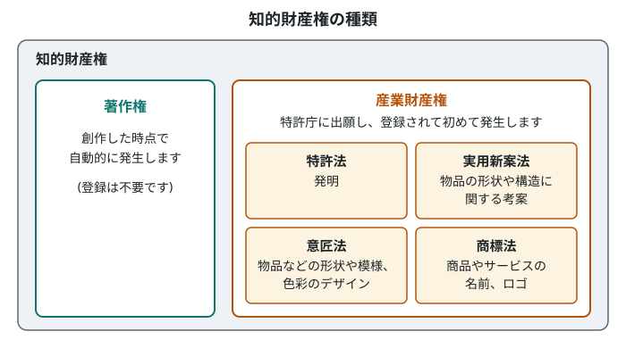

# FE テキスト 7.0 倫理・コンプライアンス

デジタルを安心・安全に使うための倫理と、システム開発やサービスの運用で守るべき法律を学びます。法律は、条文の細かい文言よりも、何を守るためのもので、どんな行為が違反になるかを押さえます。

## 7.1 情報倫理・AI 倫理

### 1. 情報倫理・情報モラル

**情報倫理**は、情報やネットワークを使うときに守るべき考え方です。**情報モラル**は、その考え方を身につけて、日常の行動に表したものです。

| 用語 | 内容 | 例 |
|---|---|---|
| デジタルシティズンシップ | デジタル技術を、他者や社会に配慮して、責任をもって活用する市民としての考え方 | 使うことを禁止するのではなく、よい使い方を身につける |
| ELSI(Ethical, Legal and Social Issues) | 技術の倫理的・法的・社会的な課題。技術の研究や導入の前に検討する | 顔認証の導入前に、プライバシーや法令、社会への影響を調べる |
| デジタルタトゥー | ネットに出た情報が、コピーや拡散で消えにくいこと | 削除した投稿が、保存されて残る |
| アテンションエコノミー | 人の注目を稀少な資源とみなし、集めることに価値を置く考え方 | 刺激的な見出しや、通知で、滞在時間を延ばす |
| オーバーシェアリング | 自分や周囲の情報を、必要以上に公開してしまうこと | 留守の日程や位置情報を細かく投稿する |
| エコーチェンバー | 似た意見の人ばかりが集まり、同じ意見が反響して強まる現象 | 自分と近い人だけをフォローして、世の中の大多数も同じだと思い込む |
| フィルターバブル | サービスが利用者の好みに合う情報ばかりを見せ、触れる情報が偏る現象 | 推薦された動画ばかりを見て、異なる情報に触れない |
| 有害サイトアクセス制限 | 有害なサイトを見られなくする仕組み(フィルタリング) | 子どものスマートフォンにフィルタリングを設定する |

エコーチェンバーは、利用者が自分で選んだ相手が原因です。フィルターバブルは、サービスの推薦の仕組みが原因で、利用者が気づきにくい点が違います。

誤った情報や有害な情報は、悪意と事実かどうかで 3 つに分けます。

| 用語 | 悪意 | 情報の内容 | 例 |
|---|---|---|---|
| ミスインフォメーション | なし | 誤り | 古い避難情報を、善意で投稿する |
| ディスインフォメーション | あり | 虚偽 | 人をだますために、デマを流す |
| マルインフォメーション | あり | 事実 | 嫌がらせで、他人の住所や病歴を公開する |

### 2. AI 倫理・AI ガバナンス

AI を安心して使うために、判断の理由、人の関与、データの扱い、組織の管理が問われます。

| 用語 | 内容 |
|---|---|
| 説明可能な AI(XAI: Explainable AI) | AI の判断の理由を、人が理解できるようにする考え方や技術 |
| 説明可能性 | AI の判断の根拠を、人に説明できること |
| 解釈可能性 | AI の仕組みそのものを、人が理解できる度合い。決定木のような単純なモデルは、解釈しやすい |
| ヒューマンインザループ(HITL) | AI の処理の流れに、人による確認、修正、最終判断を組み込む設計。重大な判断で重要 |
| AI サービスのオプトアウトポリシー | 入力した情報を、モデルの学習に使わせないための設定や方針。社外秘を扱うときは、利用の前に確認する |
| AI ガバナンス | AI を組織として適切に管理し、統制する仕組み全体。点検と見直しまで含む |
| AI 利用ポリシー | 利用してよい用途や、入力してはいけない情報などを定めた、組織のルール。AI ガバナンスの一部 |

AI のリスクや脅威には、次のものがあります。

| 用語 | 内容 | 対策 |
|---|---|---|
| ハルシネーション | 生成 AI が、事実と異なる内容を、もっともらしく出力する | 重要な内容は、公式の情報で確かめる |
| 古い出力情報 | 学習した時点より後の出来事を知らず、古い情報を出力する | 最新の情報が必要なときは、別の情報源で確かめる |
| ディープフェイク | AI で作った、本物そっくりの偽の映像や音声 | 重要な指示は、別の手段で本人に確認する |
| スロップスクワッティング | AI が提案した実在しないパッケージ名を、攻撃者が悪意あるパッケージとして公開して待ち構える手口 | 提案されたパッケージが実在し、信頼できるか確かめてから導入する |

スロップスクワッティングは、人の打ち間違いを狙うタイポスクワッティングに似ていますが、AI の提案を悪用する点が違います。

### 3. 技術者倫理

技術者は、作ったものが社会に大きな影響を与えるので、法令を守るだけでなく、社会への責任を果たすことが求められます。

| 用語 | 内容 |
|---|---|
| 技術者の倫理綱領 | 技術者が判断に迷ったときの、拠り所となる行動の指針。法律のような強制力はない |
| 技術者の社会的責任 | 作ったものが、社会や利用者に与える影響に責任を持つこと |
| モラル(遵法の意識) | 法令や社会のルールを守る意識。法令に違反しなければよい、というものではない |
| プロフェッショナリズム | 専門家として、誠実に、知識と技能を磨き、責任を持って行動すること |
| 集団思考(グループシンク) | 結束の強い集団で、全員一致を重んじるあまり、異論が出ず、判断を誤ること。疑問を言いやすい雰囲気や、反対意見を出す役で防ぐ |
| 内部告発 | 組織の不正を、外部に通報すること。公益通報者保護法の要件を満たせば、通報者は保護される |

## 7.2 ビジネス関連法規

### 1. 知的財産権

**著作権法**

- 著作権は、創作した時点で自動的に発生します。登録は不要です(無方式主義)。
- 保護されるのは、具体的な**表現**です。アイデアは保護されません。プログラムでは、ソースコードや実行形式は保護されますが、プログラム言語、規約、解法(アルゴリズム)は保護されません。

| 用語 | 内容 |
|---|---|
| 著作者人格権 | 著作者の人格を守る権利(公表権、氏名表示権、同一性保持権など)。譲渡できない |
| 著作財産権 | 財産として扱う権利(複製権など)。譲渡できる |
| 職務著作 | 法人の発意で、従業員が職務として作った著作物は、契約や就業規則に別段の定めがなければ、法人が著作者になる。プログラムの著作者も会社になる |
| 二次的著作物 | 翻訳、編曲、翻案などで、元の著作物をもとに作った著作物。利用には、元の著作者の許諾も必要 |
| 引用 | 公表された著作物を、公正な慣行に合う形で、目的上必要な範囲で使うこと。自分の文章が主、引用が従で、区別できる形にし、出典を示す |
| 情報解析・非享受利用 | 人が味わうことを目的としない利用(機械学習のデータ作成など)は、著作権者の利益を不当に害しない限り、原則として許諾なしにできる(著作権法第 30 条の 4) |

**産業財産権**

| 法律 | 保護するもの | 例 |
|---|---|---|
| 特許法 | 発明 | 新しい技術。ビジネスモデル特許は、ビジネスの方法を、コンピューターなどを使って具体的に実現する仕組みとして、発明の要件を満たしたもの |
| 実用新案法 | 物品の形状や構造に関する考案 | 小さな工夫 |
| 意匠法 | 物品などの形状や模様、色彩のデザイン | 製品の見た目 |
| 商標法 | 商品やサービスの名前、ロゴ | アプリの名前やロゴ |

産業財産権は、特許庁に出願して、登録されて初めて発生します。著作権とは違い、登録が必要です。

知的財産権の種類を、集合の形で表した図です。

**知的財産の適用と管理**

| 用語 | 内容 |
|---|---|
| ライセンサー | 使用を許諾する側(権利を持つ側) |
| ライセンシー | 使用の許諾を受けて使う側 |
| ライセンス管理 | 許諾された範囲(台数、利用者、期間)を超えないよう、使用状況を把握し、管理すること。著作権管理も同じ目的 |
| コピーガード | 複製を防ぐ技術 |
| DRM(デジタル著作権管理) | デジタルコンテンツの複製や再生、閲覧できる端末などを、技術的に制限して、著作権を守る仕組み |
| CPRM | デジタル放送の録画を、記録メディアに保存するときの、複製を制御する著作権保護の技術 |

### 2. 労働関連法規

| 法律 | 内容 |
|---|---|
| 労働基準法 | 賃金、労働時間、休日などの、労働条件の最低基準を定める。基準を下回る約束は、合意があっても無効 |
| 労働者派遣法 | 労働者派遣のしくみを定める |
| 公益通報者保護法 | 要件を満たして通報した人を、解雇などの不利益な取扱いから守る。通報を理由にした解雇は無効 |

**労働者派遣**は、派遣労働者が、派遣元と雇用契約を結び、派遣元と派遣先の派遣契約に基づいて、派遣先で働きます。仕事の指揮命令は、派遣先が行います。

| | 雇用契約 | 派遣契約 | 指揮命令 |
|---|---|---|---|
| 派遣 | 派遣元と労働者 | 派遣元と派遣先 | 派遣先 |
| 請負 | 受注者と労働者 | (なし) | 受注者(発注者は行わない) |

請負契約なのに、発注者が技術者に直接指揮命令をすると、実態は派遣になります。これを偽装請負といい、労働者派遣法に違反するおそれがあります。

### 3. 取引関連法規

**不正競争防止法**は、公正な競争を守る法律です。

| 用語 | 内容 |
|---|---|
| 営業秘密 | 次の 3 要件を満たす情報。秘密管理性(秘密として管理)、有用性(事業に役立つ)、非公知性(公然と知られていない)。特許の取得は要件ではない |
| 限定提供データ | 業として特定の者に提供する、電磁的な方法で相当量蓄積・管理されている情報。秘密として管理していなくても、不正な取得や使用が不正競争になる |
| コピープロテクト外し | コピーガードなどの技術的な制限を無効にする装置やプログラムを提供する行為。不正競争として禁止される |

**取引に関する法律**

| 用語 | 内容 |
|---|---|
| 請負契約 | 受注者が仕事の完成を約束し、成果物の引き渡しと引き換えに報酬を受け取る。完成した成果物の不具合には、契約不適合責任を負う。発注者は指揮命令をしない。完成を約束せず、作業そのものを委託するのは準委任契約 |
| 電子消費者契約法 | ネットの契約で、事業者が申し込み内容の確認・訂正の措置を設けていないとき、消費者の操作ミスによる申し込みを取り消せる |
| 特定商取引法 | 通信販売などの取引で、事業者に広告での表示を義務づけ、消費者を守る。事業者の名称、所在地、連絡先、価格、送料、支払方法、返品の条件などを表示する |
| 特定デジタルプラットフォームの透明性及び公正性の向上に関する法律 | 大規模なオンラインモールやアプリストアの事業者に、取引条件の開示や、運営状況の報告を求める |
| 資金決済法 | 電子マネー(前払式支払手段)など、決済に関する規制を定める |

### 4. 企業間の取引に関わる契約

| 用語 | 内容 |
|---|---|
| 外部委託契約 | 業務の一部を、外部に委託する契約。請負や準委任の形がある |
| 守秘契約(NDA) | 開示された秘密情報を、漏らさない、目的以外に使わないと約束する契約。秘密情報を渡す前に結ぶ |
| ソフトウェア使用許諾契約(ライセンス契約) | ソフトウェアを使う権利を許諾する契約。許諾の範囲を超えて使うと、契約違反になる |
| ボリュームライセンス契約 | 同じソフトウェアを、大量に使う組織向けに、まとめて契約する方式 |
| CAL(Client Access License) | サーバー製品に接続するクライアント(利用者や端末)ごとに必要になるライセンス |
| OSS ライセンス | オープンソースソフトウェアの利用条件。GPL は、派生物も同じライセンスで、ソースコードを提供させる(コピーレフト)。MIT ライセンスや BSD ライセンスは、主に著作権表示とライセンス文の保持が条件 |
| ソフトウェア開発契約 | ソフトウェアの開発を委託する契約。請負または準委任 |
| ソフトウェア開発委託モデル契約 | 経済産業省が示したモデル契約。工程ごとに契約を分ける(多段階契約)考え方を取り入れ、要件定義は準委任契約にするなど、工程の性質に合わせる |

### 5. その他デジタル関連法規・ガイドライン

| 用語 | 内容 |
|---|---|
| デジタル社会形成基本法 | デジタル社会の形成に関する基本理念、国・地方公共団体・事業者の責務、施策の基本を定める |
| 官民データ活用推進基本法 | 国、地方公共団体、事業者が持つデータ(官民データ)を、活用しやすくする |
| 人工知能関連技術の研究開発及び活用の推進に関する法律(AI 基本法) | AI の研究開発と活用を推進する基本の法律。内閣府などは AI 法と呼ぶ。2025 年 6 月に公布され、2025 年 9 月 1 日に全面施行された。基本理念、国の責務、人工知能基本計画、人工知能戦略本部の設置などを定める。禁止や罰則を並べる規制法ではない |
| 情報流通プラットフォーム対処法 | 旧プロバイダ責任制限法。ネット上の権利侵害で、被害者が発信者情報開示請求や、送信防止措置依頼(削除の依頼)をする手続きを定める。大規模なプラットフォーム事業者に、削除の申出への対応の迅速化と、運用状況の透明化も求める |
| 金融商品取引法 | 株式などの取引を公正にして、投資家を守る。インサイダー取引の禁止、有価証券報告書、内部統制報告書の提出などを定める |
| 適格請求書等保存方式(インボイス制度) | 登録を受けた売り手が、登録番号などを記載した適格請求書を発行する。買い手は、その保存が、仕入税額控除の条件になる |

**標準化関連**

| 用語 | 内容 |
|---|---|
| デファクトスタンダード | 市場での普及の結果、事実上の標準になったもの |
| フォーラム標準 | 企業などが、フォーラムやコンソーシアムを作り、合意して決める標準 |
| デジュールスタンダード | ISO や JIS のような、公的な標準化機関が定める標準 |
| データの標準 | 文字コードなど。JIS コード、シフト JIS コードは日本語向け。Unicode は、世界の多くの文字を 1 つの体系で扱う |

## 7.3 プライバシー関連法規

### 1. プライバシー保護に関する法規・ガイドライン

**個人情報保護法**は、個人情報を守りながら、適切に活用するための法律です。

| 用語 | 内容 |
|---|---|
| 個人情報 | 生存する個人に関する情報で、特定の個人を識別できるもの(氏名、氏名と生年月日の組み合わせ、顔写真など)。個人識別符号を含む |
| 個人識別符号 | それだけで個人を識別できるものとして定められた符号。顔や指紋などの身体の特徴を変換したデータ、マイナンバー、運転免許証番号、旅券番号など。携帯電話番号、メールアドレス、クレジットカード番号は、当たらない |
| 個人データ | 検索できるようにデータベースにまとめた個人情報 |
| 保有個人データ | 個人データのうち、事業者が開示、訂正、利用停止などの請求に応じる権限を持つもの |
| 要配慮個人情報 | 不当な差別や偏見につながるおそれのある情報(人種、信条、社会的身分、病歴、犯罪の経歴、犯罪により害を被った事実など)。取得には、原則として本人の同意が必要 |
| 匿名加工情報 | 特定の個人を識別できず、元に戻せないように加工した情報。決められた基準と公表などの条件で、同意なしに第三者に提供できる |
| 仮名加工情報 | ほかの情報と照合しない限り、特定の個人を識別できないように加工した情報。内部での分析に使いやすい。原則として第三者に提供できない |

匿名加工情報は元に戻せません。仮名加工情報は、照合すれば識別できます。

| 用語 | 内容 |
|---|---|
| マイナンバー法(番号法) | マイナンバーを使える事務を、社会保障、税、災害対策などに限る。マイナンバーを含む個人情報が特定個人情報 |
| 特定個人情報の適正な取扱いに関するガイドライン | 事業者が、特定個人情報を取り扱うときの、安全管理などの考え方を示す |
| 個人情報保護委員会 | 個人情報保護法を所管する、国の独立した機関。報告の要求、指導、助言、勧告、命令などを行う |
| プライバシーマーク制度 | 個人情報の取扱いが適切な事業者を、民間団体が認定する制度。取得は任意 |
| 一般データ保護規則(GDPR) | EU の個人データ保護の規則。EU 域内の個人のデータを扱う場合、EU 域外の企業にも適用されることがある。違反には高額の制裁金がある |

### 2. プライバシー保護に関する手法・技法

| 用語 | 内容 |
|---|---|
| オプトイン | 本人が事前に同意した場合にだけ、提供や利用を行う方式 |
| オプトアウト | 本人が拒否するまでは、提供や利用を行う方式 |
| 第三者提供 | 個人データを、本人や事業者以外に提供すること。原則として、本人の同意が必要 |

**第三者提供の例外**には、法令に基づく場合などがあります。利用目的の達成に必要な範囲で、取扱いを委託する場合は、委託先が第三者に当たらず、同意は不要です。ただし、委託元は、委託先を監督する責任があります。また、本人の同意がなくても、あらかじめ本人に知らせ、個人情報保護委員会に届け出た場合(オプトアウトによる第三者提供。要配慮個人情報は除く)や、共同利用、事業の承継の場合は、第三者提供の制限を受けません。

## 7.4 セキュリティ関連法規

### 1. 刑法・不正アクセス禁止法

**刑法**には、不正指令電磁的記録に関する罪(ウイルス作成罪)があります。

- 正当な理由なく、他人のコンピューターで、利用者の意図に反する動作をさせる不正なプログラムを、作成、提供、実行させる、取得、保管すると罪になります。
- ウイルス対策の研究や、検証用の環境での分析のように、正当な理由があれば、罪にならない場合があります。

**不正アクセス禁止法**(不正アクセス行為の禁止等に関する法律)は、コンピューターの不正な利用を禁止します。

| 用語 | 内容 |
|---|---|
| アクセス制御機能 | ID とパスワード、生体認証などで、利用者を確認して、利用を制限する機能 |
| 不正アクセス行為 | アクセス制御機能を回避して、他人のコンピューターを利用する行為 |

- 他人の ID とパスワードを、無断で使ってログインする(なりすまし)ことは、不正アクセス行為です。
- 不正アクセスに使う目的で、他人の ID とパスワードを取得したり、不正に取得されたものを保管したりすること、他人に提供すること、偽サイトなどで入力させて取得すること(フィッシング)も禁止されています。
- 許可を得て行う脆弱性診断は、不正アクセス行為ではありません。

### 2. その他のセキュリティ関連法規

| 用語 | 内容 |
|---|---|
| サイバーセキュリティ基本法 | サイバーセキュリティの施策の基本理念を定め、国、地方公共団体、重要な社会基盤の事業者などの責務を明らかにする |
| 特定電子メール法 | 広告宣伝メールは、原則として、事前に同意した人にだけ送る(オプトイン方式)。送信者の名称や、拒否の連絡先も表示する。例外として、取引関係にある者や、名刺などで自分のアドレスを通知した者などには、同意なしに送れる |
| サイバー対処能力強化法(能動的サイバー防御) | 重大なサイバー攻撃を未然に防ぐため、官民の情報共有や、通信情報を使った攻撃の分析などを可能にする。攻撃元のサーバーへのアクセス・無害化の措置は、同時に成立した整備法による警察官職務執行法と自衛隊法の改正で定められた。警察のアクセス・無害化措置の規定は 2026 年 10 月 1 日に施行。ほかの制度の施行時期は、公式の情報で確認する【要確認】 |

個人の技術者が、ウイルス対策の研究をする、許可を得て診断をする、などの場面でも、法律に触れないか、正当な理由と許可があるかを確かめる習慣が大切です。
