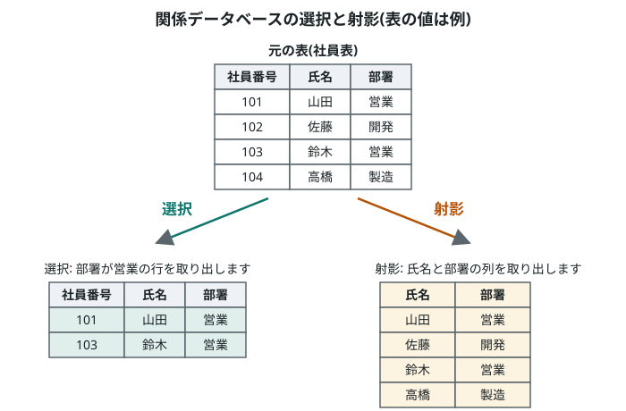
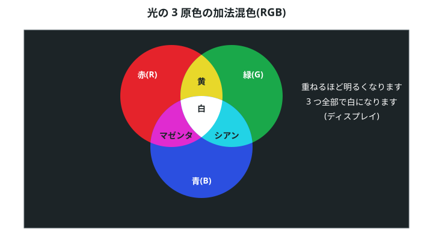
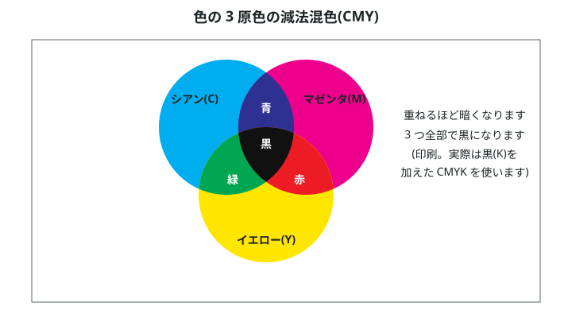

# ITパスポート テキスト 4.0 デジタル技術

仕事で使うシステム、コンピュータ、クラウド、ネットワーク、データベース、AI、情報の表現の基礎を学びます。シラバスの大分類 4(中分類 13〜19)に対応します。

## 4.1 デジタルサービス・デジタルツール

### 1. ビジネスシステム

会社の仕事を支えるシステムです。「何を管理するか」で見分けます。

| システム | 管理するもの、目的 |
|---|---|
| **ERP**(企業資源計画) | 会計、人事、生産、販売などの基幹業務の情報を統合して管理し、経営資源を有効に使う |
| **CRM**(顧客関係管理) | 顧客の購入履歴や問合せを管理し、顧客との良い関係を築く(顧客情報システムの代表) |
| **SFA**(営業支援システム) | 商談の進み具合や訪問の記録を共有し、営業活動を支援する |
| **SCM**(サプライチェーンマネジメント) | 原材料の調達から製造、物流、販売までの流れを、企業の枠を超えて全体で最適にする |
| **VCM**(バリューチェーンマネジメント) | 事業の活動ごとに価値を生み出す流れを管理し、競争力を高める |
| **HCM**(人的資本管理) | 従業員のスキルや成果を、価値を生む「資本」として管理し、育成や配置に生かす |
| **POS システム** | 店舗で商品が売れた時点で、商品名、価格、数量、時刻などを記録する |
| 販売管理システム | 受注、出荷、請求、売上を管理する |
| 購買管理システム | 発注、仕入れ、支払いを管理する |
| 流通情報システム、物流情報システム | 商品の流通や、輸送と保管の情報を管理する |
| **エンタープライズサーチ** | 社内の文書やデータベースを横断して検索する |
| **CDN**(Content Delivery Network) | Web コンテンツのコピーを各地のサーバーに置き、利用者に近いサーバーから配信する。表示が速くなり、元のサーバーの負荷も下がる |

### 2. 行政システムと公共情報システム

| 名前 | 内容 |
|---|---|
| **ガバメントクラウド** | 政府や自治体の情報システムが共通で使う、国が整備するクラウド基盤 |
| **e-Gov** | 行政手続のオンライン申請や、法令の検索などができるポータルサイト |
| 電子調達システム | 国などの入札や契約をオンラインで行う仕組み |
| **J アラート**(全国瞬時警報システム) | 緊急情報を、国から人工衛星と地上回線で自治体へ送り、防災行政無線などを自動で起動して住民に知らせる |
| **マイナポータル** | 行政手続のオンライン申請や、自分の情報の確認ができる、個人向けのサービス |
| **GNSS**(全球測位衛星システム)応用システム | 人工衛星の電波で現在位置を求める仕組み。GPS はその一つ。カーナビやスマートフォンの地図に応用される |
| **GIS**(地理情報システム) | 位置に関する情報を、地図に重ねて表示、分析する。出店場所の検討や防災に使う |

### 3. エンジニアリングシステム(生産)

| 名前 | 内容 |
|---|---|
| **かんばん方式** | 後の工程が使った分だけ、前の工程が部品を補充する。在庫を減らす |
| **JIT**(ジャストインタイム) | 必要なものを、必要なときに、必要な量だけ作る、調達する考え方 |
| リーン生産方式 | むだをなくして生産の効率を高める考え方。JIT を柱の一つにする |
| **セル生産方式** | 1 人または少人数が、作業台(セル)で、組立ての全体を担当する |
| **FA**(ファクトリーオートメーション) | 工場の設備を自動化する |
| **MES** | 製造現場の状況を把握し、作業の指示と実績の収集を行う |
| **CAD** | コンピュータで、製品や建物の設計図を作る |

### 4. EC システムと金融のデジタル化

- **EC**(電子商取引)システムには、電子受発注(オンラインモール、オンラインショッピング、電子入札)があります。
- **EDI**(電子データ交換)は、企業間の受発注や請求などのデータを、通信回線で標準的な形式で交換する仕組みです。
- 電子決済システムの一つが**キャッシュレス決済**です。非接触 IC 決済(カードやスマートフォンをかざす)と QR コード決済が代表です。**インターネットバンキング**は、銀行の取引をインターネットで行うサービスです。
- **フィンテック**(FinTech)は、金融(Finance)と技術(Technology)を組み合わせたサービスの総称です。
- **アカウントアグリゲーション**は、複数の金融機関の口座の情報を、一つの画面にまとめて表示するサービスです。
- **暗号資産**(仮想通貨)は、インターネットで、決済や投資に使える、電子的な資産です。同じ単位のものは同じ価値で交換できます。
- **NFT**(Non-Fungible Token)は、ブロックチェーンの技術で、デジタルデータに唯一性を持たせ、所有の証明などに使います。「代替できない」トークンです。

### 5. デジタルツール

| 分類 | 例 |
|---|---|
| **デジタルワークプレイス** | 場所や時間にとらわれずに働けるように、各種のツールを一つの環境にまとめた、ネットワーク上の仕事の場 |
| コミュニケーションツール | チャット、SNS、電子掲示板、ブログ |
| **グループウェア** | ファイル共有、タスク管理、スケジュール共有、オンライン会議システム、ワークフローシステム(申請と承認の流れの電子化) |
| **CMS**(コンテンツ管理システム) | HTML の専門知識がなくても、Web サイトの文章や画像を作成、更新、管理する |

### 6. オフィスツール

- **文書作成ソフト**: **差込み印刷**(住所録の氏名や住所を、文書に 1 通ずつ差し込んで印刷)、**インデント**(行頭の位置を下げる、字下げ)、**均等割付**(指定した幅に、文字を均等に配置)。
- **表計算ソフト**: セルの参照には、コピーすると位置が変わる**相対参照**(`B2`)と、変わらない**絶対参照**(`$F$1`)があります。`$` を付けた列や行は、コピーしても固定されます。**ピボットテーブル**(ピボットデータ表)は、明細のデータを、観点を入れ替えながら集計する機能です。
- **プレゼンテーションソフト**: スライドを作成します。**テンプレート**(ひな形)を使うと、統一した見た目で作れます。

## 4.2 システムの種類・構成

### 1. サイバーフィジカルシステムと IoT

| 用語 | 内容 |
|---|---|
| **サイバーフィジカルシステム(CPS)** | 現実(フィジカル)のデータを、センサーなどで集めてサイバー空間で分析し、結果を現実に戻して制御や意思決定に生かす仕組み |
| **IoT** | 機器をインターネットにつなぎ、状態を集めたり、遠隔で操作したりする |
| **デジタルツイン** | 現実の設備や環境を、サイバー空間に双子のように再現し、シミュレーションや故障の予測に使う |
| **スマートファクトリー** | 工場の機器や工程をデータでつなぎ、自動化と最適化を進めた工場 |
| **エッジコンピューティング** | データを、遠くのクラウドに送らず、発生源に近い場所で処理する。遅延と通信量を減らせる |
| **フィジカル AI** | AI を、ロボットや自動運転車などの機械に組み込み、現実を認識して判断し、自ら動かす |

サイバーフィジカルシステム(CPS)で、現実とサイバー空間の間をデータが行き来する流れを表した図です。

```text
[Physical] 現実: センサーなどで、現実のデータを集める
     |
     v
[Cyber]    サイバー空間: 集めたデータを分析する
     |
     v
[Physical] 現実: 結果を戻して、制御や意思決定に生かす
```

IoT の機器は、**センサー**(温度、光、動きなどを検知して電気信号にする入力の部品)と、**アクチュエーター**(電気信号を、モーターなどの動きに変える出力の部品)で構成されます。

### 2. 民生機器と産業機器

- **ホームネットワーク**: 家庭内の家電などをつなぐネットワーク。**スマートスピーカー**は、音声で操作でき、家電も操作できます。
- **ウェアラブルコンピュータ**: 腕時計のように身に着けて使う情報機器。
- **ドローン**: 遠隔操作や自動で飛ぶ無人の航空機。
- **VR ゴーグル**(仮想空間の映像で視界を覆う)、**AR グラス**(現実の景色にデジタルの情報を重ねる)、**MR グラス**(現実と仮想を融合する)、**スマートグラス**(めがね型の情報機器)。
- コンピュータの種類: デスクトップ PC、ノート PC、サーバ、モバイル端末(スマートフォン、タブレット端末)。
- **MaaS**: 複数の移動手段を、一つのサービスとして、検索、予約、決済できるようにする考え方。
- **ロボット**、**スマートメーター**(通信機能を持つ電力量計で、使用量を自動で検針する。スマートメーターと、通信網、データを管理するシステムをまとめた仕組みを **AMI** という)、**コネクテッドカー**(通信機能を持つ自動車)。
- **自動運転レベル**: レベル 0(運転者がすべて行う)、レベル 1(加速・減速かハンドル操作のどちらかを支援)、レベル 2(両方を支援。運転者は常に監視)、レベル 3(条件付きで、システムが運転。必要なときは運転者が対応)、レベル 4(特定の条件で、システムがすべて行う)、レベル 5(あらゆる条件で、システムがすべて行う)。

### 3. コンピュータの構成要素

| 区分 | 用語 | 内容 |
|---|---|---|
| プロセッサ | **CPU** | 制御と演算を行う、コンピュータの頭脳 |
| | **GPU** | 画像処理などで、多数の演算を並列に行う |
| | **GPGPU** | GPU の並列処理を、画像処理以外(AI の学習など)にも使う |
| メモリ | メモリ(主記憶装置) | CPU が直接読み書きする、作業用の記憶 |
| | **RAM** | 読み書きできるメモリ。電源を切ると内容が消える |
| | **DRAM** | 主記憶に使う。安く大容量。定期的な書き直し(リフレッシュ)が必要。**DDR** は規格 |
| | **SRAM** | 高速で高価。書き直し不要。CPU のキャッシュメモリに使う |
| | **ROM** | 読み出し専用。電源を切っても消えない |
| 入出力インタフェース | **USB** | 周辺機器をつなぐ有線の規格 |
| | **HDMI** | 映像と音声を、デジタルで送る有線の規格 |
| | **Bluetooth** | 数 m から数十 m の近距離の無線 |
| | **NFC** | 数 cm の近距離の無線。非接触 IC カードやタッチ決済 |
| | **デバイスドライバ** | OS が周辺機器を制御するためのソフトウェア |
| | **プラグアンドプレイ** | つなぐと、OS が自動で認識して設定する仕組み |

### 4. 入出力装置と記録媒体

- **入力装置**: ポインティングデバイス(マウス、タッチデバイス)、キーボード、スキャナー、**OCR**(画像の中の文字を、テキストデータにする)、**生体認証装置**(指紋、顔などで本人を確認する)。
- **出力装置**: 液晶ディスプレイ(バックライトが必要)、**有機 EL ディスプレイ**(画素自体が発光)、ヘッドマウントディスプレイ、レーザープリンター、インクジェットプリンター、**3D プリンター**(立体物を造形する)。
- **記録媒体**: **ハードディスク(HD)装置**(回転する磁気ディスクに記録。衝撃に弱い)、**SSD**(フラッシュメモリを使う。高速で衝撃に強い)、SD カード、**光学ドライブ**(CD、DVD などをレーザー光で読み書きする)、フラッシュメモリ。

### 5. OS とファイルシステム

- **Windows 系 OS**(マイクロソフト)、**Mac 系 OS**(アップル)、**UNIX**(古くからサーバーなどで使われ、Linux や macOS など、多くの OS に影響を与えた)。
- **ショートカット**は、ファイルやフォルダーへの参照を、別の場所に作る仕組みです。ショートカットを削除しても、元のファイルは消えません。
- **ディレクトリパス・ファイルパス**は、ファイルの場所を表す文字列です。ルートから書く絶対パスと、今のディレクトリから見た相対パスがあります。`..` は一つ上のディレクトリです。

例: 今のディレクトリが `/home/user/docs` のとき、`../photos/a.jpg` は、`/home/user/photos/a.jpg` を指します。

### 6. 信頼性設計とシステムの評価

**RAID** は、複数のディスクを組み合わせて、速度や信頼性を高める技術です。

| 方式 | 内容 | 1 TB のディスク 2 台のとき |
|---|---|---|
| RAID 0(**ストライピング**) | データを分けて、複数のディスクに同時に書く。高速。1 台が壊れるとデータを失う | 使える容量は 2 TB |
| RAID 1(**ミラーリング**) | 同じ内容を、複数のディスクに書く。1 台が壊れても残りで動ける | 使える容量は 1 TB |

RAID 0 と RAID 1 で、データがディスクにどう書かれるかを比べた図です。1 TB のディスク 2 台の場合です。

```text
RAID 0 (striping)
  data    A B C D
  Disk 1  A   C
  Disk 2    B   D     分けて書く。使える容量は 2 TB。1 台が壊れるとデータを失う

RAID 1 (mirroring)
  data    A B C D
  Disk 1  A B C D
  Disk 2  A B C D     同じ内容を書く。使える容量は 1 TB。1 台が壊れても残りで動ける
```

A〜D は、分けたデータのまとまりです。

**スケールアウト**は、サーバーの台数を増やして性能を上げる方法です。**スケールアップ**は、1 台の性能(CPU やメモリ)を増強する方法です。

**RASIS** は、システムの評価の観点です。

| 文字 | 観点 | 内容 |
|---|---|---|
| R | 信頼性(Reliability) | 故障しにくく、正常に動き続ける |
| A | 可用性(Availability) | 必要なときに使える |
| S | 保守性(Serviceability) | 点検や復旧がしやすい |
| I | 保全性(Integrity) | データに矛盾が起きず、正しく保たれる |
| S | 安全性(Security) | 不正なアクセスから守られている |

**稼働率**は、システムが動いている割合です。

- 稼働率 = MTBF ÷ (MTBF + MTTR)。MTBF は平均故障間隔、MTTR は平均修理時間です。
- 直列(全部が動く必要がある)の稼働率 = 各装置の稼働率の積。
- 並列(1 台でも動けばよい)の稼働率 = 1 −(各装置が止まる確率の積)。

例: 稼働率 0.9 の装置を 2 台。直列は 0.9 × 0.9 = 0.81、並列は 1 − 0.1 × 0.1 = 0.99 です。

稼働率 0.9 の装置 A と B を、直列と並列につないだ図です。

```text
Series(直列)
  in --> [A 0.9] --> [B 0.9] --> out     全部が動く必要がある。0.9 × 0.9 = 0.81

Parallel(並列)
          +--> [A 0.9] --+
          |              |
  in -----+              +--> out        1 台でも動けばよい。1 − 0.1 × 0.1 = 0.99
          |              |
          +--> [B 0.9] --+
```

## 4.3 クラウド

### 1. クラウドサービスの種類

利用者が管理する範囲が違います。

| 種類 | 提供されるもの | 利用者が管理する範囲 |
|---|---|---|
| **SaaS**(Software as a Service) | 完成したソフトウェア(Web メールなど) | 利用者のアカウントや設定 |
| **PaaS**(Platform as a Service) | アプリを開発し、動かすための基盤(OS、ミドルウェア) | アプリケーションとデータ |
| **IaaS**(Infrastructure as a Service) | 仮想サーバー、ストレージ、ネットワーク | OS、ミドルウェア、アプリ、データ |

SaaS、PaaS、IaaS の順に、利用者の自由度が高くなり、利用者が管理する範囲も広くなります。

クラウドの種類ごとに、利用者が管理する層を表した図です。U は利用者が管理する層、. は事業者が管理する層です。

```text
          SaaS  PaaS  IaaS
            .     U     U     アプリケーションとデータ
            .     .     U     OS、ミドルウェア
            .     .     .     仮想サーバー、ストレージ、ネットワーク
```

SaaS の利用者は、アカウントや設定だけを管理します。

### 2. 提供形態

| 形態 | 内容 |
|---|---|
| **パブリッククラウド** | 事業者が、不特定多数の利用者に提供する |
| **プライベートクラウド** | 特定の組織だけが専用に使う。自由度が高く、要件に合わせやすいが、費用がかかる |
| **ハイブリッドクラウド** | プライベートクラウドやオンプレミスと、パブリッククラウドを組み合わせて使う |
| **マルチクラウド** | 複数の事業者のクラウドサービスを使い分ける |

### 3. オンプレミスとクラウドの違い

**オンプレミス**は、自社の設備でシステムを運用する形態です。設備を購入するので、初期の費用が大きく、仕様を自由に決められます。クラウドは、設備を借りるので、従量課金が多く、必要に応じて資源を増減しやすく、設備の管理を提供者に任せられます。仕様は、提供者のサービスの範囲に限られます。

### 4. クラウドと仮想化の基盤技術

**仮想化**は、1 台の物理的なコンピュータを、複数の仮想的なコンピュータに見せる技術です。物理的な資源を有効に使えます。

| 方式 | 内容 |
|---|---|
| **ホスト型** | ホスト OS の上で、仮想化ソフトを動かし、その上でゲスト OS を動かす。個人の PC での検証に向く |
| **ハイパーバイザー型** | ホスト OS を介さず、ハードウェアの上で、ハイパーバイザーを直接動かす。オーバーヘッドが小さい |
| **コンテナ型** | ホスト OS のカーネルを共有し、ゲスト OS を持たずに、アプリと必要なものを分離して動かす。軽く、起動が速い |

仮想化の 3 つの方式で、重なる層がどう違うかを並べた図です。Virtual SW は仮想化ソフトです。

```text
Host type     Hypervisor type  Container type
[App]         [App]            [App]
[Guest OS]    [Guest OS]       [Host OS]
[Virtual SW]  [Hypervisor]     [Hardware]
[Host OS]     [Hardware]
[Hardware]
```

コンテナ型は、ゲスト OS を持たず、ホスト OS のカーネルを共有します。

**クラスタ**は、複数のコンピュータを連携させて、1 台のコンピュータのように使う技術です。処理を分散でき、1 台が故障しても、ほかのコンピュータが処理を引き継げます。仮想化とは逆の向きの考え方です。

## 4.4 ネットワーク

### 1. ネットワークの種類

- **LAN**: 建物や敷地の中などの、限られた範囲のネットワーク。**有線 LAN** は LAN ケーブルでつなぎ、安定しています。**無線 LAN** は電波でつなぎます。**無線 LAN アクセスポイント**は、無線 LAN の端末と有線 LAN を中継する装置で、ネットワークの名前を **SSID** で表します。
- **WAN**: 離れた拠点の LAN を、通信事業者の回線で結ぶ、広い範囲のネットワーク。
- **インターネットサービスプロバイダ(ISP)**: インターネットへの接続サービスを提供する事業者。

### 2. インターネットの技術

| 用語 | 内容 |
|---|---|
| **IPv4** | IP アドレスが 32 ビット。約 43 億個。足りなくなってきた |
| **IPv6** | IP アドレスが 128 ビット。非常に多くのアドレスを使える |
| **グローバル IP アドレス** | インターネットで使う、重複しないアドレス |
| **プライベート IP アドレス** | 組織の内部だけで使う。範囲は 10.0.0.0/8、172.16.0.0/12、192.168.0.0/16 |
| **NAT** | プライベート IP アドレスとグローバル IP アドレスを変換し、複数の機器が 1 つのグローバル IP アドレスを共有してインターネットに接続できるようにする。複数の機器が同時に共有するときは、ポート番号も変換する NAPT(IP マスカレード)を使う。NAPT も NAT の一種として扱われる |
| **DNS** | ドメイン名と IP アドレスを対応づける |
| **ドメイン** | インターネット上の組織やサーバーを識別する名前(`example.com` など) |
| **ファイアウォール** | ネットワークの境界で、通信を許可するか遮断するかをルールで制御する |

### 3. ネットワーク接続装置

| 装置 | 内容 |
|---|---|
| **ハブ** | 受け取ったデータを、すべてのポートに送る |
| **スイッチングハブ** | 宛先の MAC アドレスを見て、必要なポートにだけ送る |
| **ルータ** | 異なるネットワークの間で、宛先の IP アドレスをもとに、経路を選んで中継する |
| **プロキシサーバー** | 利用者の代わりに、Web サーバーなどへアクセスする。取得した内容を保存して再利用したり、閲覧できるサイトを制限したりできる |

### 4. 通信プロトコル

**IP アドレス**は、ネットワークの中の機器を識別する番号です。**サブネットアドレス**(ネットワークアドレス)と、**サブネットマスク**で、ネットワーク部と、機器を表すホスト部に分けます。

- サブネットマスク `255.255.255.0`(`/24`)は、最初の 24 ビットがネットワーク部です。`192.168.1.0/24` の機器に割り当てられるアドレスは、`192.168.1.1`〜`192.168.1.254` の 254 個です。`192.168.1.255` は、ホスト部がすべて 1 の、ブロードキャストアドレスです。
- **ブロードキャスト**: 同じネットワークのすべての機器に送る。
- **マルチキャスト**: 特定のグループの複数の機器に送る。
- ユニキャスト: 1 つの宛先に送る。

| プロトコル | 内容 |
|---|---|
| **TCP** | 確認応答や再送で、データの到達を確かにする。Web、メールなどで使う |
| **UDP** | 確認応答や再送をしない。速く、遅延が少ない。音声通話や動画の配信などで使う |
| **HTTP** | Web ブラウザと Web サーバーの通信(既定のポート番号 80) |
| **HTTPS**(HTTP over TLS) | HTTP を TLS で暗号化して、盗聴や改ざんを防ぐ(既定のポート番号 443) |
| **SMTP** | メールの送信と、サーバー間の転送 |
| **POP3** | メールを端末に取り込んで受信する |
| **IMAP** | メールをサーバーに置いたまま、複数の端末から同じ状態で見る |
| **FTP** | ファイルの転送 |
| **DNS** | ドメイン名と IP アドレスの対応づけ |
| **DHCP** | IP アドレスなどを、機器に自動で割り当てる |

**ポート番号**は、通信相手のコンピュータの中で、どのアプリケーションに渡すかを識別する番号です。

インタフェース: **イーサネット**は、LAN ケーブルを使う有線 LAN の規格です。**Wi-Fi** は、無線 LAN の機器の相互接続を業界団体が認定した規格のブランド名です。**メッシュ Wi-Fi** は、複数の機器が網の目のように連携して、家全体に電波を届けます。

### 5. ネットワークの応用

**電子メール**:

- **MIME**: 日本語、画像、添付ファイルなど、文字以外のデータを扱えるようにする規格。
- **HTML メール**: 文字の装飾や画像を使えるメール。
- **Web メール**: Web ブラウザで読み書きするメールのサービス。

**Web ブラウジング**:

- **cookie**: Web サーバーが、ブラウザに保存させる小さなデータ。ログイン状態の維持などに使う。
- **URL**: 情報の場所を表す。`https://www.example.com/docs/a.html` は、プロトコル(`https`)、ホスト名(`www.example.com`)、パス(`/docs/a.html`)でできている。

**モバイル通信**:

| 用語 | 内容 |
|---|---|
| **LTE** | 4G の仲間の、モバイル通信の規格 |
| **5G**(第 5 世代移動通信システム) | 高速大容量、低遅延、多数同時接続が特徴 |
| **ローカル 5G** | 企業や自治体などが、特定の建物や敷地で、自ら構築して使う 5G |
| **MNP** | 事業者を変えても、同じ電話番号を使い続けられる制度 |
| **テレマティクス** | 自動車などの移動体に通信システムを組み込み、位置や走行の情報をやりとりする。運行の管理などに使う |
| **ショートメッセージサービス(SMS)** | 電話番号を宛先にして、短い文字のメッセージを送る |
| **SIM カード** | 契約者の情報を記録した IC カード |
| **eSIM** | 端末に組み込まれた SIM。契約の情報を通信で設定できる |
| **IMEI** | 携帯電話などの端末ごとの固有の番号 |
| **プラチナバンド** | 700〜900 MHz 帯などの、低い周波数帯。障害物を回り込みやすく、屋内や山間部でもつながりやすい |
| **ローミング** | 契約している事業者以外のネットワークや、海外のネットワークで通信を使う |
| **テザリング** | スマートフォンの回線を、ほかの機器と共有する |
| **LPWA** | 低消費電力で、広い範囲に、少量のデータを送る。IoT のセンサーなどで使う |

## 4.5 データベース

### 1. 関係データベース

**RDBMS**(関係データベース管理システム)は、データを、行と列からなる**表**(テーブル)で管理します。**関係モデル**では、表を**関係(リレーション)**と呼び、行は 1 件のデータ(レコード)、列は項目(属性)です。操作には SQL という言語を使います。

### 2. データベースの設計

- **エンティティ**: 管理する対象(社員、部署、商品など)。
- **リレーションシップ**: エンティティの間の関連(社員は部署に所属する)。
- **主キー**: 表の中の行を一意に識別する列。値が重複したり、空になったりしてはいけません。社員表なら、社員番号です。
- **正規化**: データの重複や矛盾を減らすために、表を分割して整理すること。

### 3. データの操作(関係演算)

| 演算 | 内容 |
|---|---|
| **選択** | 条件に合う**行**を取り出す |
| **射影** | 必要な**列**を取り出す |
| **結合** | 複数の表を、共通の項目で組み合わせる |



### 4. トランザクション処理

**トランザクション**は、まとまった一連の処理です。「すべて成功する」か「何もしなかったことにする」かのどちらかです。

| 用語 | 内容 |
|---|---|
| **コミット** | 処理が成功したときに、変更を確定する |
| **ロールバック** | 途中で障害が起きたときに、変更を取り消して、元の状態に戻す |
| **同時実行制御(排他制御)** | 同じデータを同時に更新しても矛盾しないように、先に使っている処理が、データをロックして、ほかの処理を待たせる |
| **デッドロック** | 複数の処理が、互いに相手がロックしたデータの解放を待ち続けて、どちらも進めなくなる状態 |

トランザクションが、確定(コミット)か取消し(ロールバック)で終わる流れを表した図です。

```text
[Start]  一連の処理を始める
    |
    v
[Work]   処理を進める
    |
    +--- success ---> [Commit]    すべて成功したので、変更を確定する
    |
    `--- failure ---> [Rollback]  途中で障害が起きたので、変更を取り消して元の状態に戻す
```

## 4.6 AI 技術

### 1. 機械学習

AI が、データから規則を学ぶ方法です。

| 種類 | 内容 | 例 |
|---|---|---|
| **教師あり学習** | 入力と正解(ラベル)の組で学習する | 迷惑メールの判定 |
| **教師なし学習** | 正解を与えず、データの構造やグループを見つける | 似た顧客のグループ分け |
| **強化学習** | 試行錯誤して、報酬が大きくなる行動を学ぶ | ロボットの制御、ゲームの AI |

**過学習**は、学習に使ったデータに合わせすぎて、新しいデータでは精度が下がる状態です。学習用のデータと、評価用のデータを分けて、精度を比べると見つけられます。

### 2. ディープラーニング

**ニューラルネットワーク**は、人間の脳の神経細胞のつながりをまねた数理モデルです。入力層、隠れ層、出力層からなります。**ディープラーニング(深層学習)**は、隠れ層を多く重ねた、ニューラルネットワークによる機械学習です。データから特徴を自動で学習できます。大量のデータと計算の資源が必要です。

応用の例:

- **自然言語処理モデル**: 文章の翻訳、要約、質問への回答。
- **音声処理モデル**: 音声のテキスト化(音声認識)や、テキストからの音声合成。
- **画像認識モデル**: 画像や映像の中の物体を識別する。

### 3. 生成 AI

- **大規模言語モデル(LLM)**: 大量の文章で事前に学習し、文章の生成、要約、翻訳などを行うモデル。文章の続きとして、もっともらしい言葉を出力するため、事実と異なる内容を答える(ハルシネーション)ことがあります。
- **トークン**: LLM が文章を処理するときの単位。単語や文字、その一部。一度に扱える長さの上限や、料金の計算に使われます。
- **コンテキスト内学習**(In-Context Learning): プロンプトに、望む回答の例をいくつか示すと、モデルを再学習しなくても、その例に倣った出力になること。
- **検索拡張生成(RAG)**: 回答を作る前に、社内の文書などから関連する情報を検索し、プロンプトに加えることで、最新の情報や、社内固有の情報にもとづいた回答を作りやすくする方法。

## 4.7 情報デザイン・情報メディア

### 1. 情報デザイン

**デザインの基本原則**:

| 原則 | 内容 |
|---|---|
| **近接** | 関連する要素を近くにまとめる |
| **整列** | 要素の端や中心をそろえる |
| **反復** | 同じ色や形を繰り返して、統一感を出す |
| **対比** | 大きさや色に差をつけて、重要な点を目立たせる |

**LATCH の法則**は、情報を整理する 5 つの方法です。場所(Location)、アルファベット順(Alphabet。五十音順を含む)、時間(Time)、カテゴリー(Category)、階層(Hierarchy。大きさや重要度の順)。

**インフォグラフィック**は、情報やデータを、図、イラスト、グラフなどで、視覚的に分かりやすく表現したものです。

### 2. ユーザーインタフェース

- **ユーザーインタフェース(UI)**: 利用者と機器やソフトウェアの接点(画面、ボタン、操作の方法)。人と機械の間の接点全般を、**ヒューマンインタフェース**と呼びます。
- **ユーザビリティ**: 特定の利用者が、特定の目的を、効果的、効率的、満足して達成できる度合い(使いやすさ)。
- **アクセシビリティ**: 高齢者や障害のある人なども含め、多くの人が情報や機能を利用できる度合い。画像に代替テキストを付ける、文字と背景のコントラストを十分にとる、などの工夫があります。
- **ジェスチャーインタフェース**: 体や指の動きで操作する方式。**マルチタッチインタフェース**の操作は、**タップ**(軽く触れる)、**スワイプ**(指をすべらせる)、**フリック**(指で素早くはじく)、**ピンチ**(2 本の指の間隔を変えて、拡大、縮小)、**ロングプレス**(押したまま離さない)などです。

### 3. ユニバーサルデザイン

- **ユニバーサルデザイン**は、年齢、性別、障害の有無などにかかわらず、できるだけ多くの人が使えるように、最初から設計する考え方です。**7 原則**は、公平な利用、利用における柔軟性、単純で直感的な利用、認知できる情報、エラーに対する寛容さ、身体的負担の少ない利用、接近や利用のための大きさと空間です。
- **インクルーシブデザイン**: これまで設計から取り残されがちだった人も、設計の段階から参加させる考え方。
- **ピクトグラム**: 言葉を使わず、単純な図で意味を伝える絵文字(非常口のマークなど)。

### 4. デジタルメディアの技術

**メディアデータの種類**:

| 種類 | 形式 | 特徴 |
|---|---|---|
| 音声 | **MIDI** | 演奏の情報(音の高さ、長さ、強さ)を数値で記録する。音そのものではない |
| | **WAV** | 音を記録する。一般に圧縮しない |
| | **MP3** | 非可逆圧縮で、データ量を小さくする |
| 画像 | **JPEG** | 写真向き。フルカラー。非可逆圧縮 |
| | **GIF** | 最大 256 色。簡単なアニメーションが可能。可逆圧縮 |
| | **PNG** | 可逆圧縮。背景を透明にできる |
| | **BMP** | 圧縮しない形式が一般的。データ量が大きい |
| 動画 | **MPEG** | 動画や音声の圧縮の規格。MP3 も MPEG の音声の規格の一つ |
| | **H.265** | 動画の圧縮の方式。H.264 より高い圧縮率。高解像度の動画にも使う |

- **ラスターデータ**(ビットマップデータ)は、画素の集まりで、拡大するとぼやけます。**ベクターデータ**は、点と線の数値で図形を記録するので、拡大しても劣化しません。
- 動画は、静止画の 1 コマ(**フレーム**)を、続けて表示します。1 秒あたりのフレーム数が**フレームレート**(fps)です。例: 30 fps で 10 秒なら、30 × 10 = 300 フレーム。
- 画素数 × 1 画素のビット数 ÷ 8 で、圧縮しない画像のバイト数が求められます。例: 1,920 × 1,080 画素、24 ビット(3 バイト)なら、2,073,600 × 3 = 6,220,800 バイト(約 6.2 MB)。

**データの圧縮**:

- **ZIP** などで、データ量を小さくします。**圧縮率** = 圧縮後のデータ量 ÷ 圧縮前のデータ量(圧縮率の定義は、問題文の指定に従う)。
- **可逆圧縮**: 完全に元に戻せる。ZIP、PNG。
- **非可逆圧縮**: 完全には元に戻らないが、圧縮率を高くできる。JPEG、MP3。

**色の表現**:

- 色の三属性: **色相**(色の種類)、**明度**(明るさ)、**彩度**(鮮やかさ)。
- **光の 3 原色(RGB)**: 赤、緑、青。重ねるほど明るくなる**加法混色**。すべてを最大にすると白。ディスプレイで使います。
- **色の 3 原色(CMY)**: シアン、マゼンタ、イエロー。重ねるほど暗くなる**減法混色**。印刷では、黒(K)を加えた **CMYK** を使います。
- **画素(ピクセル)**: 画像を構成する点。**ppi**(pixels per inch)は、1 インチあたりの画素数で、画面の細かさ。**dpi**(dots per inch)は、1 インチあたりの点の数で、主に印刷の細かさ。





### 5. デジタルメディアの応用

- **ペイント系ソフトウェア**(ラスター形式)と、**ドロー系ソフトウェア**(ベクター形式)。
- **フォトレタッチ**: 写真の補正や加工。**レイヤー**: 画像を層に分けて編集する機能。**トリミング**: 必要な部分を切り出す。
- **XR**(クロスリアリティ): VR(仮想現実)、**拡張現実(AR)**、MR(複合現実)などの総称。**メタバース**は、インターネット上の、多人数が参加できる仮想空間です。
- **4K/8K**: 映像の解像度。4K は 3,840 × 2,160 画素、8K は 7,680 × 4,320 画素。8K は、縦と横がそれぞれ 2 倍なので、画素数は 4 倍。
- **モーションキャプチャ**: 人の動きをセンサーやカメラで記録し、3D のキャラクターの動きに使う。
